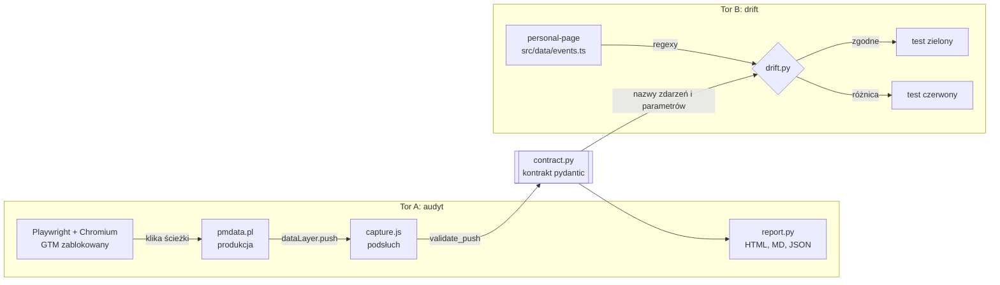
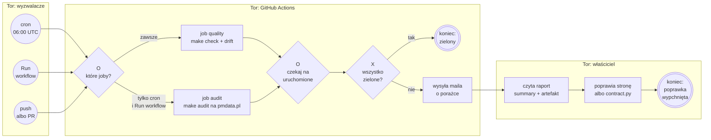

# datalayer-contract-audit

Automatyczny audyt zdarzeń dataLayer pod GA4 na https://pmdata.pl/. Playwright sam przechodzi
ścieżki użytkownika z zablokowanym GTM, a pydantic waliduje każdy push względem kontraktu.

> **Status:** gotowy — 12 scenariuszy, codzienny audyt w GitHub Actions.

## Problem

Tracking psuje się po cichu. Ktoś zmienia nazwę przycisku, refaktoruje komponent albo baner
zgód — strona działa, a w GA4 znika konwersja albo parametr przychodzi pusty. Wychodzi to po
tygodniach, gdy danych nie da się już odzyskać. Ręczny audyt w GTM Preview to kilkanaście minut
klikania, których nikt nie powtarza po każdym deployu. Ten projekt robi to automatycznie.

## Jak to działa

1. **Kontrakt** — tracking plan strony (`events.ts`) przepisany na modele pydantic. Każde
   zdarzenie i komenda `gtag()` ma typ, wymagane parametry i reguły biznesowe, np. „przed
   decyzją użytkownika wszystkie zgody są `denied`”.
2. **Podsłuch** — skrypt wstrzyknięty przed kodem strony owija `dataLayer.push` i zapisuje
   kopię każdego pusha w chwili wysłania.
3. **Scenariusze** — testy klikają baner zgód, e-mail, LinkedIn, czat, menu mobilne i stopkę
   artykułu, każdy w świeżej przeglądarce (pusty `localStorage`).
4. **Walidacja i raport** — każdy push przechodzi przez kontrakt; wynik ląduje w JSON, z którego
   powstaje raport HTML i Markdown.

## Dwa tory: audyt i drift

Kontrakt (`contract.py`) to ręczna kopia tracking planu. Walidacja pushy nie czyta `events.ts` —
robi to osobny test driftu, który pilnuje, żeby kopia nie rozjechała się z oryginałem.

**DFD — co płynie między plikami** (bloki to komponenty, strzałki to dane):



| | Tor A: audyt | Tor B: drift |
|---|---|---|
| Pytanie | Czy żywa strona pushuje to, czego oczekuje kontrakt? | Czy kontrakt zgadza się z `events.ts`? |
| Co bierze z `contract.py` | całe modele: typy, pola, reguły (`validate_push`) | tylko nazwy zdarzeń i parametrów (`EVENT_MODELS`, `event_params`) |
| Wchodzi na pmdata.pl | tak | nie |
| Lokalnie | `make e2e` / `make audit` | `make check` |
| W CI | job `audit`: cron 06:00 UTC + ręczny „Run workflow” | job `quality`: każdy push na `main`, PR i ten sam cron |
| Łapie | błędy implementacji: zły parametr, brak pusha, zła kolejność | zmianę planu bez zmiany kontraktu (inaczej A świeciłby na zielono według starych oczekiwań) |

B porównuje tylko nazwy i klucze parametrów; reguły typu „`link_url` wskazuje linkedin.com”
łapie wyłącznie A. `events.ts` B bierze lokalnie z `../personal-page` (albo z `TRACKING_PLAN_PATH`;
brak pliku = test pominięty), a w CI z prywatnego repo tokenem `PERSONAL_PAGE_TOKEN`
(fine-grained PAT: tylko `personal-page`, Contents: read, ważny do 01.10.2027). Brak pliku w CI
to błąd, nie pominięcie — po wygaśnięciu tokenu `quality` zrobi się czerwony.

## Kiedy audyt się uruchamia

Mac (ręcznie) i GitHub Actions to dwa niezależne przebiegi na różnych komputerach.

| Sytuacja | Gdzie | Co |
|---|---|---|
| `make audit-open` | Mac | scenariusze + raport w `reports/`, otwiera Chrome |
| Codziennie 8:00 (7:00 zimą) | GitHub | `quality` + `audit` |
| Run workflow w Actions | GitHub | `quality` + `audit` |
| Push do **tego** repo | GitHub | tylko `quality`; `audit` szary, bo zmiana kodu audytu nie jest powodem, żeby odwiedzać produkcję |
| Deploy **personal-page** | — | **nie uruchamia** — złapie to najbliższy poranny audyt |

Po deployu strony, bez czekania do rana: Actions → CI → Run workflow
(albo `gh workflow run CI --repo pmackowka/datalayer-contract-audit`).

**Proces — kto co robi i kiedy** (imitacja BPMN: subgraph = tor/rola, koło = start, podwójne
koło = koniec, `X` = bramka wyłączna, `O` = inkluzywna — czeka tylko na uruchomione joby):



Wypchnięta poprawka to nowy `push`, czyli nowy przebieg od startu. Wyzwalacze, cron i kroki
jobów są w `.github/workflows/ci.yml`.

## Wyniki

| | Mac | GitHub Actions |
|---|---|---|
| Raport | `reports/audit-<data>-<godzina>.html` w Chrome | **audit summary** pod grafem jobów (Markdown) + **Artifacts** → `audit-<numer>` (ZIP: HTML, MD, JSON) |
| Trace przy porażce | `test-results/` — nagranie każdej akcji | brak (repo publiczne, trace zawiera adres e-mail) |
| Historia | wszystkie raporty w `reports/` | przebiegi w Actions, artefakty 30 dni |
| Porażka | raport otwiera się mimo to | mail od GitHuba; nieudany scenariusz rozwinięty z błędem |

Raporty z obu miejsc się nie mieszają, więc czasy i godzina się różnią. Nazwa pliku ma godzinę
w UTC (`audit-2026-10-02-053412` = 07:34 latem); nagłówek raportu pokazuje oba czasy.

## Ręczny audyt

Komendy uruchamiasz w katalogu projektu (`make` szuka `Makefile` w bieżącym katalogu).

```bash
make setup && cp .env.example .env   # Python 3.12, .venv, biblioteki, Chromium bez okna (~1 min)
make check                           # lint, typy, testy, drift; zielony = linia "... passed"
make audit-open                      # 12 scenariuszy (~10 s), raport w reports/, otwiera Chrome
make open-report                     # najnowszy raport bez uruchamiania audytu
make audit                           # audyt + raport bez przeglądarki (tak działa CI)
make e2e                             # same scenariusze, pushe w terminalu, bez raportu
make e2e-headed                      # widoczne okno, pauza 500 ms między kliknięciami
make help                            # pełna lista
uv run pytest -m e2e -k chat -s      # jeden scenariusz (-k filtruje po nazwie)
PWDEBUG=1 uv run pytest -m e2e -k chat               # krok po kroku w Playwright Inspector
uv run playwright show-trace test-results/*/trace.zip  # porażka: zrzuty, DOM, sieć
```

W `.env` wpisz `GTM_LOADER_GLOB` — wzorzec ścieżki first-party loadera GTM, który testy blokują.
Bez niego scenariusze nie ruszą. Plik jest poza gitem: opisana wprost ścieżka loadera w publicznym
repo to gotowy wpis dla list blokujących reklamy.

## Jak czytać raport

HTML i Markdown mają tę samą treść w tej samej kolejności.

1. **Werdykt** — „Zgodny z planem” tylko przy 100% we wszystkich trzech wskaźnikach:
   **pokrycie planu** (każde z 8 zdarzeń `events.ts` odpaliło poprawnie choć raz),
   **zgodność z kontraktem** (każdy push, także `gtag`, przeszedł walidację),
   **scenariusze zielone** (kolejność i parametry zgodne z planem). Każdy z liczbami, nie tylko %.
2. **Zdarzenia z planu** — ile razy odpaliło, ile poprawnie, status i w których scenariuszach.
   To obserwacja: `cookie_consent_marketing` pojawia się wszędzie, gdzie zgoda marketingowa była
   udzielona, nie w jednym scenariuszu.
3. **Scenariusze** — zwinięte, nieudane rozwinięte. W środku każdy push z czasem w ms od wczytania
   strony, na dole zablokowane żądania — zwykle jedno, loader GTM.

## Bezpieczeństwo produkcji

Loader GTM i endpoint czatu są blokowane na poziomie sieci, zanim żądanie opuści przeglądarkę —
nic nie trafia do GA4. Kliknięcia w LinkedIn i `mailto:` są anulowane: zdarzenie trafia do
dataLayer, przejście nie następuje. Czat jest tylko otwierany. Scenariusze idą sekwencyjnie.

## Koszty i utrzymanie

- **Minuty Actions** są darmowe (repo publiczne); przebieg trwa 1–2 minuty.
- **Cron** liczony w UTC: `0 6 * * *` = 8:00 latem, 7:00 zimą; start bywa opóźniony o kilkanaście
  minut. W publicznym repo GitHub wyłącza cron po 60 dniach bez aktywności (mail wcześniej) —
  wystarczy commit albo „Enable workflow”.
- **Sekrety CI:** `PERSONAL_PAGE_TOKEN` (drift) i `GTM_LOADER_GLOB` (job `audit`). Raport pokazuje
  zablokowane żądania jako kategorię z domeną, np. „loader GTM (pmdata.pl)”, bez ścieżki.
- **Runner** przypięty do `ubuntu-24.04` — zmiana `ubuntu-latest` po stronie GitHuba nic nie zepsuje.

## Stack i dlaczego

| Narzędzie | Rola | Dlaczego to, a nie alternatywa |
|---|---|---|
| **Playwright** | Przeglądarka, podsłuch, blokada żądań | `add_init_script` rusza przed kodem strony, `route` blokuje GTM przed wyjściem żądania. W Selenium to zejście do CDP/BiDi. |
| **pydantic v2** | Kontrakt danych | Kontrakt to kod, który się uruchamia. `strict` nie zamienia po cichu `"true"` na `true`, więc łapie błędy zamiast je maskować. |
| **pytest** + pytest-playwright | Scenariusze, fixture'y | Domyślny `page` ma osłonę sieci — żaden test nie wyśle danych do GA4 przez nieuwagę. |
| **Jinja2** | Szablony raportu | Autoescape: tekst ze strony (np. `link_text`) nie wykona się w raporcie HTML. |
| **uv** | Python, zależności | Jedna komenda stawia interpreter i środowisko; `uv.lock` = te same wersje lokalnie i w CI. |
| **ruff + mypy --strict** | Lint i typy | Kontrakt pilnuje typów w danych, mypy w kodzie, który go egzekwuje. |
| **Makefile** | Jedyny interfejs | `make check` lokalnie i w CI to ta sama komenda. |
| **GitHub Actions** | Audyt cykliczny | Poranny cron łapie regresję, zanim zobaczy ją raport w GA4. |

## Decyzje, które warto znać

- **GTM zablokowany, nie wyłączony.** Produkcja nie ma wersji testowej, a dataLayer działa bez
  GTM — audyt nie generuje ani jednego hitu GA4. Hity (warstwa sieciowa) są świadomie poza zakresem.
- **Komendy gtag to tablice.** `gtag()` pushuje obiekt `arguments`; bez zamiany na tablicę sygnały
  Consent Mode znikają. Kontrakt rozpoznaje kształt pusha funkcją, nie polem `event`.
- **Nawigacje anulowane kliknięciem, nie tylko blokadą sieci.** Zablokowane przejście w tej samej
  karcie zamienia stronę na stronę błędu i podsłuch ginie razem z nią.
- **Trzy wskaźniki zamiast jednego procentu.** 7 z 8 zdarzeń to 87,5% — wygląda dobrze, nawet gdy
  brakuje akurat zgody marketingowej.
- **Jeden model raportu, dwa widoki.** Liczy wyłącznie `AuditReport`; szablony tylko formatują,
  a test pilnuje, że mają te same sekcje i teksty.

## Architektura plików

```text
datalayer-contract-audit/
├── src/datalayer_audit/
│   ├── contract.py             # kontrakt: modele pydantic zdarzeń i komend gtag
│   ├── capture.js / capture.py # podsłuch wstrzykiwany przed skryptami strony + odczyt (DataLayerSpy)
│   ├── guard.py                # osłona: blokada GTM, czatu, LinkedIn, mailto:
│   ├── checks.py               # sekwencja pushy vs oczekiwana, błędy kontraktu
│   ├── report.py               # model raportu, wskaźniki, zapis JSON/MD/HTML
│   ├── report.html.j2 / .md.j2 # szablony — lustra, te same teksty
│   └── drift.py                # kontrakt vs events.ts
├── tests/
│   ├── conftest.py             # fixture'y (page z osłoną, datalayer) + zapis raportu
│   ├── test_contract.py        # reguły kontraktu: przypadek dobry i zły
│   ├── test_capture.py         # podsłuch i osłona na stronie-atrapie
│   ├── test_report.py          # wskaźniki, escapowanie HTML, symetria widoków
│   ├── test_drift.py           # parser events.ts + drift na prawdziwym pliku
│   ├── test_smoke.py           # import pakietu, start Chromium
│   └── e2e/
│       ├── conftest.py         # powracający użytkownik (zgody w localStorage)
│       └── test_scenarios.py   # 12 scenariuszy na produkcji
├── .github/workflows/ci.yml    # quality (każdy push) + audit (cron)
├── Makefile, pyproject.toml, uv.lock, CLAUDE.md
└── reports/, test-results/     # wyniki i trace (lokalne, poza gitem)
```

Jeden scenariusz: `conftest.py` tworzy stronę z osłoną i podsłuchem → `test_scenarios.py` klika
na pmdata.pl → `checks.py` porównuje sekwencję i waliduje każdy push w `contract.py` → po
wszystkich scenariuszach `report.py` liczy wskaźniki i renderuje szablony. Zmiana na stronie
wymaga zwykle zmiany w jednym miejscu: selektor w `test_scenarios.py` albo model w `contract.py`.

## Licencja

MIT — zobacz [LICENSE](LICENSE).
