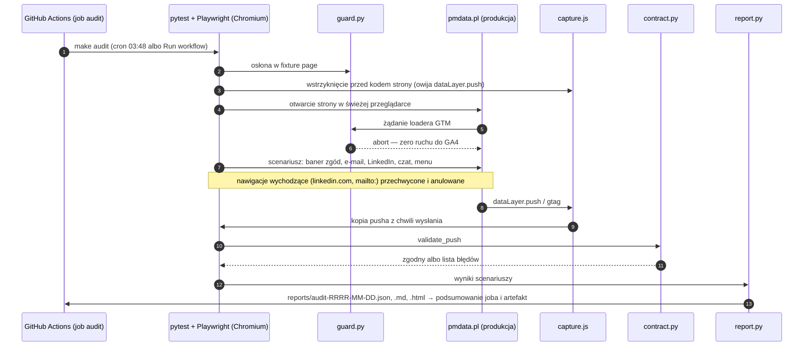

# Diagram sekwencji UML: jeden przebieg audytu

Kto wywołuje kogo w jednym scenariuszu tor A (audyt). Tor B (drift) i proces w GitHub Actions: [README](README.md).

| Krok | Kto | Po co |
|---|---|---|
| 1 | GitHub Actions | audyt codziennie, bez ręcznego klikania w GTM Preview |
| 2, 5–6 | osłona | test na produkcji nie zanieczyszcza danych GA4 |
| 3, 8–9 | podsłuch | kopia pusha z chwili wysłania, zanim strona go zmieni |
| 10–11 | kontrakt pydantic | typy, wymagane parametry i reguły biznesowe w jednym miejscu |
| 12–13 | raport | wynik czytelny bez uruchamiania testów |
